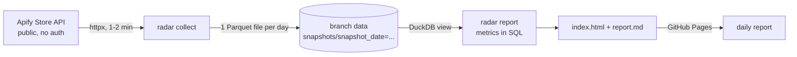

# Apify Store Radar

A small data pipeline that takes a **daily snapshot of the [Apify Store](https://apify.com/store)** and turns it into a report of which niches are growing, where demand is high but supply is thin or weak, and which popular Actors are letting their users down. It exists to decide which scraper or data API to build next, and to show a complete, free-to-run data engineering loop: ingest, store, model, publish, schedule.

Everything runs on free tiers: Python, [DuckDB](https://duckdb.org), GitHub Actions and GitHub Pages. The report itself is written in Brazilian Portuguese because it is a decision tool for its author; code and docs are in English.

**Live report:** <https://filipeeers.github.io/apify-store-radar/> (online after the first workflow run, see [Deploy it](#deploy-it-free)).



## Quick start

```bash
python -m venv .venv                # on a OneDrive-synced folder, create the venv outside the project
. .venv/bin/activate                # Windows PowerShell: .venv\Scripts\Activate.ps1
pip install -e ".[dev]"

radar run                           # today's snapshot into data/, report into site/
pytest                              # 30+ offline tests
```

| Command | What it does |
| --- | --- |
| `radar collect` | Fetches today's snapshot and writes `data/snapshots/snapshot_date=YYYY-MM-DD/actors.parquet`. Options: `--data`, `--newest-pages` (default 3), `--pause` seconds between calls (default 1), `--date` (tests and backfills). |
| `radar report` | Reads every snapshot under `--data` and writes `site/index.html` and `site/report.md`. |
| `radar run` | `collect`, then `report`. This is what the workflow runs. |

The collector identifies itself with a neutral User-Agent. Set `RADAR_USER_AGENT` to add your own contact info.

## Data model

One immutable Parquet file per day, Hive-partitioned by `snapshot_date` and queried in place with DuckDB:

```sql
SELECT snapshot_date, count(*) AS actors, sum(users_30d) AS users_30d
FROM read_parquet('data/snapshots/*/actors.parquet', hive_partitioning = true)
GROUP BY 1 ORDER BY 1;
```

One row per Actor per day, 29 columns: identity (`actor_id`, `slug`, `owner`, `title`, `categories`), usage (`users_total`, `users_90d`, `users_30d`, `users_7d`, `runs_*`, `builds_total`, `last_run_at`), quality (`rating`, `reviews`, `bookmarks`, 30-day run outcomes), pricing (`pricing_model`, primary-event `price_usd`, `pricing_started_at`), `rank_popularity` / `rank_newest` (position in that day's listings) and `collected_at`.

- **The history is the product.** The Store does not expose creation dates, so "new Actor" and "growing niche" only exist as differences between daily files.
- **Append-only.** A day's file is written once; git never has to rewrite history. Rows are sorted by slug and compressed with ZSTD level 19: about 0.83 MB per day for ~13,000 Actors, roughly 300 MB per year.
- **Raw and derived are separate.** Niches are computed at report time from titles, so the taxonomy can change and be re-applied to the whole history. Descriptions and picture URLs are left out on purpose: they are heavy and git keeps every day forever.
- **Storage.** In CI the files live on a dedicated `data` branch, so `main` stays code-only.

## Metrics

All of it is SQL over the `snap` view (see `src/radar/metrics.py`; thresholds are constants at the top of that file).

| Metric | Definition |
| --- | --- |
| Demand | Sum of `users_30d` over the niche's Actors. A person can count in several Actors: it is a demand proxy, not a head count. |
| Supply | Actors in the niche; **active** Actors have at least 5 users in 30 days; **devs** are distinct owners (ten Actors from one developer are one competitor). |
| Concentration | The leader's share of the niche's users, plus the share held by official `apify/` Actors (about 35% of all Store users). |
| Growth | **Δ7d**: users 7d now over users 7d in the snapshot 7 to 14 days older, minus 1, only over Actors present in both (same-store, so entering or leaving the window does not fake growth). **Ritmo**: (users 30d ÷ users 90d) of the niche over the same ratio for the whole Store. Ritmo works from the first snapshot; new Actors score high by construction, so read it as "new or accelerating" and confirm with Δ7d. |
| Quality gap | An Actor with 30+ users that succeeds in under 85% of 100+ runs, or is rated under 3.5 by 5+ reviewers. The niche's gap share is the demand sitting on such Actors. |
| Under-served | At least 100 users, 1 to 12 active Actors, leader holds at most 80% and Apify at most 50%; ranked by users per active Actor. |
| Entrants | Actors first seen in the last 14 days (after the very first snapshot). A `rank_newest` means a genuinely new launch. |
| Personal-data hint | A warning when most of a niche's titles mention profiles, e-mails, followers or social networks. A keyword heuristic, not a legal analysis. |

**Niches** come from titles, which follow "&lt;Target&gt; &lt;Thing&gt; Scraper" closely: the *target* is the site or product (`instagram`, `google`, `mercado livre`), the *niche* adds what is extracted (`instagram reel`, `google maps`). Two-word targets are learned from the data; marketing words, emoji and prices are stripped; categories are reported separately. It is a transparent heuristic, so every row shows its leading Actor for a sanity check.

## What the Store API gives you (measured 2026-11-10)

`GET https://api.apify.com/v2/store?limit=1000&offset=N&sortBy=popularity` is public, but:

- `offset` stops working at **15,000** for every `sortBy`: later pages come back empty, even though `total` says ~115,000.
- About **15% of each page is silently dropped** (a `limit=1000` page may hold 855 items) and smaller pages do not recover them.
- `total` wobbles between calls and `desc` is ignored.

So one ordering sees at most ~12,600 Actors. The collector reads `popularity` until the first empty page, then adds 3 pages of `newest` (about 500 Actors outside the popularity window). That is ~13,000 distinct Actors in about 18 requests.

## Deploy it (free)

1. Create a **public** GitHub repository and push this code. Public repos get unlimited Actions minutes and free Pages.
2. *Settings, Pages, Build and deployment, Source*: **GitHub Actions**.
3. *Actions, daily-snapshot, Run workflow*. The first run creates the `data` branch. After that it runs every day at 05:23 UTC ([`.github/workflows/daily.yml`](.github/workflows/daily.yml)): collect, push the day's file to `data`, deploy the report to Pages.

To work on the history locally, bring the `data` branch in as a worktree (move any local `data/` folder away first):

```bash
git fetch origin data && git worktree add data data
```

GitHub disables scheduled workflows in repositories with no activity for 60 days and warns by e-mail first. The daily commits go to the `data` branch, so do not count on them as activity: any push to `main` does, and a disabled workflow can be re-enabled from the Actions tab.

## Roadmap

- **Try the whole Store (~115,000 Actors).** One ordering is capped at 15,000 positions, so it takes sweeps by category x ordering x `pricingModel` or `username`, and the big categories do not fit in one sweep either (Automation 47k, Lead Generation 43k, Developer Tools 31k, E-commerce 24k, Social Media 23k, AI 15k, Business 13k). Measure real coverage and storage first: daily files would be several times larger, which may mean a hot subset in git and the rest in Releases.
- Move titles and categories to an append-only dimension table (only new or changed Actors per day) to shrink the daily files.
- Per-niche trend charts once there are 30+ days of history.

## Limits

Users are not unique across Actors. The Store's popularity score is unknown, so `rank_popularity` is only comparable day to day. The long tail is under-counted (see the API section). This is an unofficial project that reads the public Store listing at about 20 requests per day.
